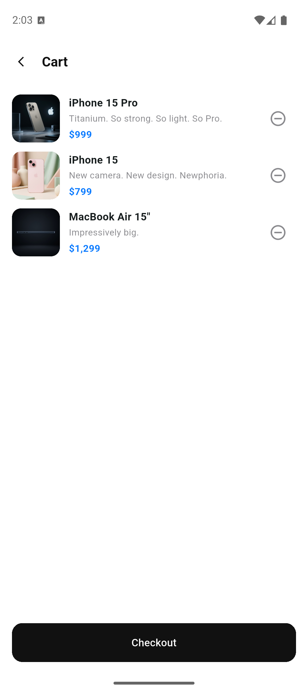
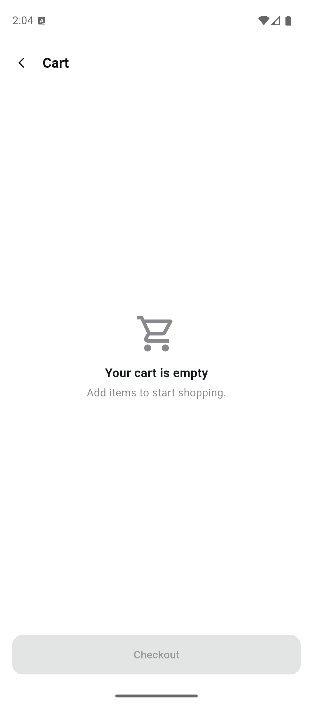

# Mini Katalog Uygulaması

**Flutter ile geliştirilmiş, arama ve sepet özellikli basit bir ürün kataloğu uygulaması. Bir haftalık Flutter eğitiminin bitirme projesidir.**

Uygulama; ürünleri iki sütunlu bir ızgarada listeler, ada göre aramaya izin verir, seçilen ürünün detayını gösterir ve ürünlerin sepete eklenip çıkarılmasını simüle eder. Ürün verisi, ürün görselleri ve banner eğitim amaçlı bir API'den canlı olarak çekilir, bu yüzden uygulamanın çalışması için internet bağlantısı gerekir. Yalnızca Flutter ile gelen `material.dart` kullanılmıştır, ekstra paket yoktur.

## Özellikler

- **Ürün ızgarası:** Ürünler `GridView.builder` ile iki sütunlu kartlar halinde listelenir.
- **Arama:** Arama kutusuna yazıldıkça ürünler ada göre anlık olarak filtrelenir.
- **Ürün detayı:** Ürünün görseli, adı, fiyatı, açıklaması ve teknik özellikleri ayrı bir sayfada gösterilir.
- **Sayfa geçişleri:** Named routes ve `Navigator.pushNamed` kullanılır, seçilen ürün detay sayfasına Route Arguments ile taşınır.
- **Sepet:** Ürünler sepete eklenip çıkarılabilir, ana sayfadaki sepet ikonunda ürün sayısı rozet olarak görünür.
- **Boş sepet durumu:** Sepette ürün yokken bilgilendirici bir boş durum ekranı gösterilir.
- **Canlı veri:** Ürünler `HttpClient` ile API'den çekilir ve `fromJson` ile model nesnelerine çevrilir, görseller `Image.network` ile gösterilir.
- **Hata durumu:** Veri alınamazsa bilgilendirici bir mesaj ve "Try again" butonu gösterilir.

## Ekran Görüntüleri

**Ana Sayfa**


**Ürün Detayı**


**Sepet**



**Boş Sepet**



## Kullanılan Teknolojiler

| Teknoloji | Kullanım amacı |
| --- | --- |
| Flutter 3.47.6 | Uygulama çatısı ve arayüz |
| Dart 3.13.5 | Programlama dili |
| Material (`material.dart`) | Arayüz bileşenleri ve tema |
| `dart:convert` | JSON verisinin çözülmesi |
| `HttpClient` (`dart:io`) | API'den ürün verisinin çekilmesi |
| `Image.network` | Ürün görsellerinin ve banner'ın internetten gösterilmesi |
| `ChangeNotifier` | Sepet state yönetimi |
| `flutter_test` | Birim testleri |

## Gereksinimler

- Flutter SDK 3.47.6 (stable) veya üzeri
- Dart SDK 3.13.5 (Flutter ile birlikte gelir)
- Android Studio (emülatör için) ve bir Android emülatörü ya da fiziksel Android cihaz
- Visual Studio Code veya Android Studio
- İnternet bağlantısı (ürün verisi ve görseller API'den çekilir)

Sürümleri ve kurulumu kontrol etmek için:

```bash
flutter --version
```

```bash
flutter doctor
```

## Kurulum

**1. Projeyi indirin**

```bash
git clone https://github.com/utkuertac/mini-catalogue-app.git
cd mini-catalogue-app
```

**2. Bağımlılıkları yükleyin**

```bash
flutter pub get
```

**3. Bir cihaz hazırlayın**

Android Studio üzerinden bir emülatör başlatın veya fiziksel bir cihaz bağlayın. Cihazın görüldüğünü doğrulayın:

```bash
flutter devices
```

**4. Uygulamayı çalıştırın**

```bash
flutter run
```

### Komutlar

| Komut | Açıklama |
| --- | --- |
| `flutter pub get` | Bağımlılıkları indirir |
| `flutter devices` | Bağlı cihazları ve emülatörleri listeler |
| `flutter run` | Uygulamayı bağlı cihazda çalıştırır |
| `flutter analyze` | Kodu statik olarak analiz eder |
| `flutter test` | Testleri çalıştırır |

## Sayfalar

| Sayfa | Rota | Açıklama |
| --- | --- | --- |
| Ana sayfa | `/` | Arama kutusu, banner ve ürün ızgarası |
| Ürün detayı | `/product` | Seçilen ürünün bilgileri ve "Add to Cart" butonu. Ürün, Route Arguments ile alınır |
| Sepet | `/cart` | Sepetteki ürünler, çıkarma butonu ve boş sepet durumu |

## Veri Modeli

Her ürün `lib/models/product.dart` içindeki `Product` sınıfıyla temsil edilir.

| Alan | Tip | Açıklama |
| --- | --- | --- |
| `id` | `int` | Ürün kimliği |
| `name` | `String` | Ürün adı |
| `tagline` | `String` | Kısa tanıtım cümlesi |
| `description` | `String` | Ürün açıklaması |
| `price` | `String` | Biçimlendirilmiş fiyat, örneğin `$999` |
| `currency` | `String` | Para birimi |
| `image` | `String` | Görselin internet adresi |
| `specs` | `Map<String, String>` | Teknik özellikler |

## Veri Kaynağı

Uygulama, eğitim ve demo amaçlı WANTAPI servisini kullanır. Veriler her açılışta canlı olarak çekilir, projede yerel kopya tutulmaz.

| Veri | Adres |
| --- | --- |
| Ürün listesi | `https://wantapi.com/products.php` |
| Banner görseli | `https://wantapi.com/assets/banner.png` |
| Ürün görselleri | Ürün listesindeki `image` alanından gelir |

Bu adresler gerçek bir e-ticaret altyapısını temsil etmez. Ürün adları ve markalar ilgili sahiplerine aittir.

## Test

Projede, `Product.fromJson` ve `toJson` dönüşümlerini doğrulayan birim testleri bulunur (`test/widget_test.dart`). Testler internet bağlantısı gerektirmez.

```bash
flutter test
```

## Proje Yapısı

```
mini-catalogue-app/
├── lib/
│   ├── main.dart                      # Uygulama girişi, tema ve rotalar
│   ├── models/
│   │   └── product.dart               # Product sınıfı, fromJson / toJson
│   ├── data/
│   │   ├── product_repository.dart    # Ürünleri API'den çeker
│   │   └── cart.dart                  # Sepet state'i (ChangeNotifier)
│   ├── routes/
│   │   └── app_routes.dart            # Rota adları
│   ├── screens/
│   │   ├── home_screen.dart           # Ana sayfa
│   │   ├── product_detail_screen.dart # Ürün detayı
│   │   └── cart_screen.dart           # Sepet
│   ├── widgets/
│   │   ├── product_card.dart          # Izgaradaki ürün kartı
│   │   └── product_image.dart         # İnternetten yüklenen ürün görseli
│   └── theme/
│       └── app_theme.dart             # Renkler ve tema
├── docs/
│   └── screenshots/                   # README'deki ekran görüntüleri
├── test/
│   └── widget_test.dart               # Model birim testleri
├── pubspec.yaml                       # Proje ayarları ve bağımlılıklar
└── LICENSE
```

## Geliştirici

Utku Ertaç — [github.com/utkuertac](https://github.com/utkuertac)

## Lisans

Bu proje [MIT Lisansı](LICENSE) ile lisanslanmıştır.
